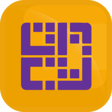
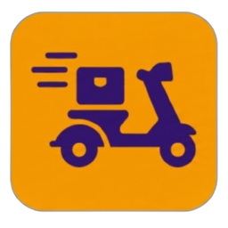
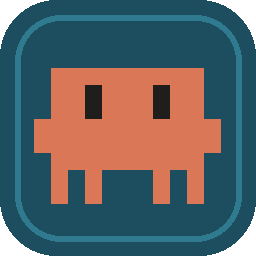
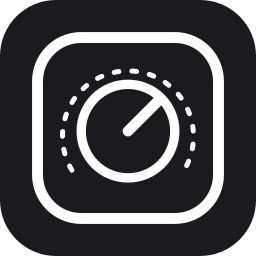

Desenvolvedor na **LC Sistemas**, construindo o ecossistema **LC Pedir** (API, painel e web). Fora do expediente, faço ferramentas que eu mesmo queria ter.

## 🏢 Projetos da LC Sistemas

<table width="100%">
  <tr>
    <td align="center" width="25%"> <b>Gourmet</b> Front + Back</td>
    <td align="center" width="25%"> <b>Balcão</b> Front + Back</td>
    <td align="center" width="25%"> <b>Força&nbsp;de&nbsp;Vendas</b> Front + Back</td>
    <td align="center" width="25%"> <b>Pay</b> Front</td>
  </tr>
  <tr>
    <td align="center" width="25%"> <b>Dashboard</b> Front + Back</td>
    <td align="center" width="25%"> <b>Coletor&nbsp;de&nbsp;dados</b> Front</td>
    <td align="center" width="25%"> <b>Portal</b> Front</td>
    <td align="center" width="25%"> <b>LC&nbsp;Pedir</b> Front + Back</td>
  </tr>
</table>

## 🛠️ Projetos pessoais

<table width="100%">
  <tr>
    <td align="center" width="50%">
      <a href="https://github.com/CassioNathan/claudinho">
         
        <b>claudinho</b>
      </a> 
      Mascote de mesa pixelado
    </td>
    <td align="center" width="50%">
      <a href="https://github.com/CassioNathan/stompdesk-releases">
         
        <b>Stompdesk</b>
      </a> 
      Pedalboard virtual para guitarra
    </td>
  </tr>
</table>

## 🧰 Stack

